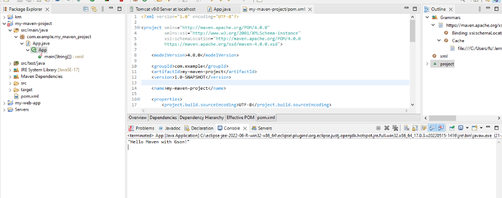
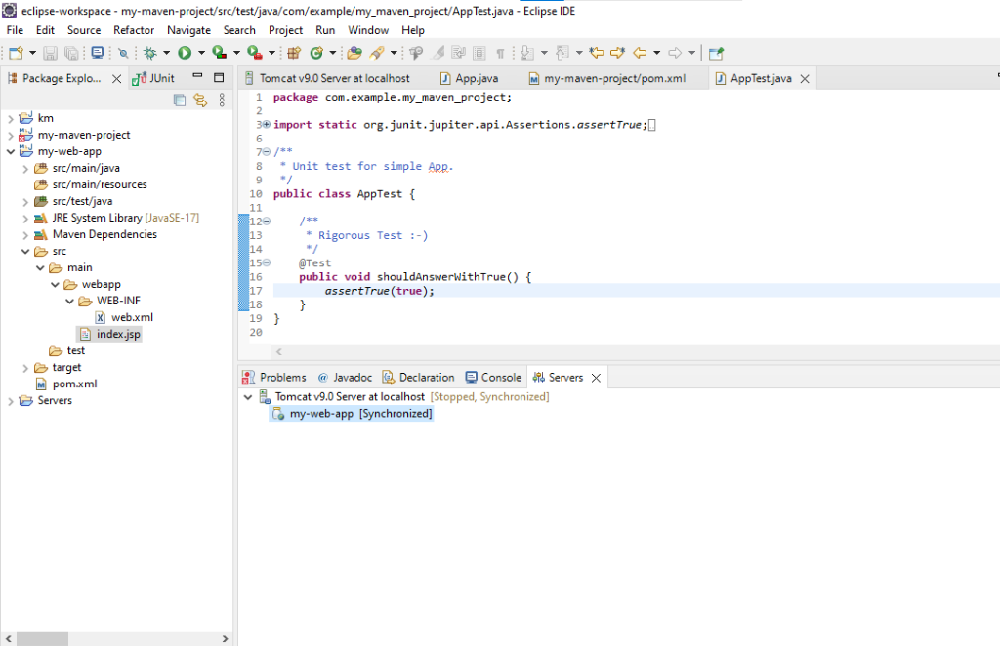

# Week 4: Maven Java SE Application and Unit Testing

Advanced Software Engineering and DevOps Lab  
Academic Year: 2026

### Authors and Contributors
* S. MANJUNATH REDDY (24BD1A665N)
* K. TANAY (24BD1A665P)

---

## Project Overview
This repository contains the Maven Java SE Application (my-maven-project) developed during Week 4. It covers:
- Standard Maven Directory Structure (src/main/java, src/test/java, target/).
- Java 17 Compilation via maven-compiler-plugin.
- External Dependency Management using Google Gson 2.13.1.
- Automated Unit Testing with JUnit 5.11.0 and Maven Surefire reporting.
- Executable JAR artifact generation.

---

## Repository Directory Structure (Including target folder)

```text
WEEK4-24BD1A665N-24BD1A665P-MavenJava/
├── pom.xml                                              # Project Object Model configuration
├── screenshots/                                         # Execution and Test Screenshots
│   ├── 01_maven_java_console_output.png
│   └── 02_junit_test_execution.png
├── src/
│   ├── main/
│   │   └── java/
│   │       └── com/example/my_maven_project/
│   │           └── App.java                             # Main Application Class (Gson JSON)
│   └── test/
│       └── java/
│           └── com/example/my_maven_project/
│               └── AppTest.java                         # JUnit 5 Unit Test Suite
└── target/                                              # Full Build Artifacts Directory
    ├── classes/                                         # Compiled Application Bytecode (.class)
    │   └── com/example/my_maven_project/App.class
    ├── test-classes/                                    # Compiled Test Bytecode (.class)
    │   └── com/example/my_maven_project/AppTest.class
    ├── surefire-reports/                                # Unit Test Results (.txt and .xml)
    │   ├── com.example.my_maven_project.AppTest.txt
    │   └── TEST-com.example.my_maven_project.AppTest.xml
    ├── maven-archiver/                                  # Build Manifest Metadata
    ├── maven-status/                                    # Compiler Plugin State
    └── my-maven-project-1.0-SNAPSHOT.jar                # Generated Binary JAR Artifact
```

---

## Execution Screenshots and Test Results

### 1. Application Execution Output (App.java with Gson)
The application serializes Java data into JSON using Google Gson and prints "Hello Maven with Gson!" to the Eclipse console.



---

### 2. JUnit 5 Unit Test Suite Execution (AppTest.java)
The JUnit 5 test suite was executed via mvn test, passing all assertions with zero failures and generating Surefire reports in target/surefire-reports/.



---

## Build and Run Instructions

### 1. Clean, Compile and Test
```bash
mvn clean test
```

### 2. Package into Executable JAR
```bash
mvn clean package
```

### 3. Run the Packaged Application
```bash
java -cp "target/my-maven-project-1.0-SNAPSHOT.jar;C:\Users\fs\.m2\repository\com\google\code\gson\gson\2.13.1\gson-2.13.1.jar" com.example.my_maven_project.App
```
**Output:**
```json
"Hello Maven with Gson!"
```
